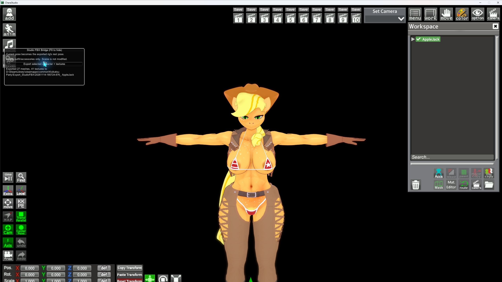
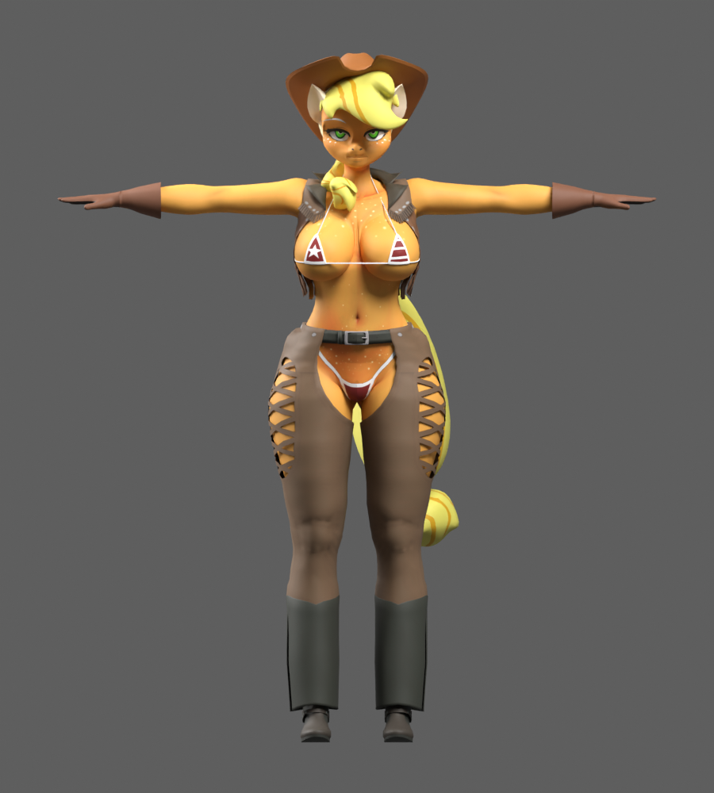
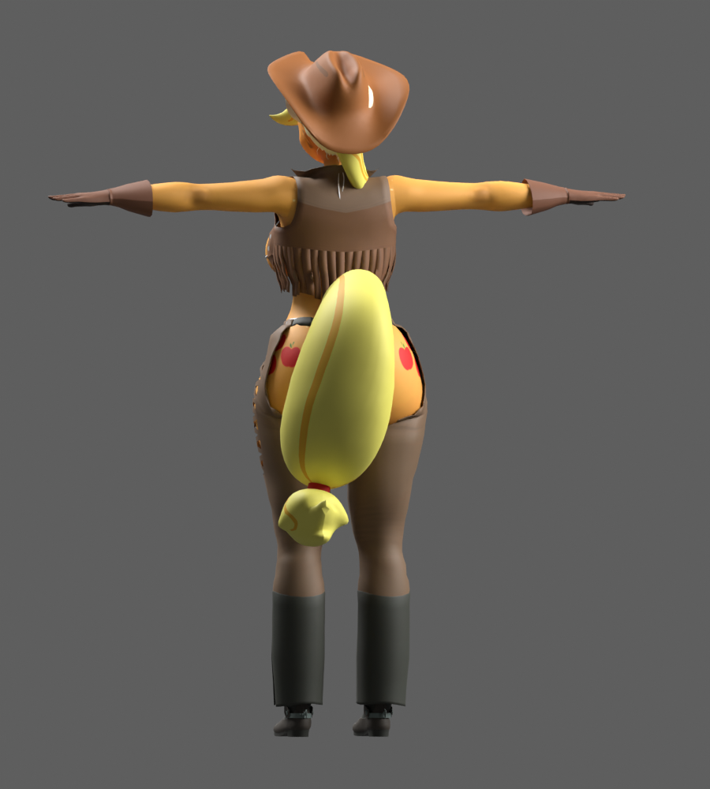

# Koikatsu: keep Maker and Studio exports

| Path | Input to converter | Pose and materials |
|---|---|---|
| Character Maker + KKBP | Top-level `model.pmx` or baked `.blend` | KKBP neutral-pose export and baked light-color materials |
| CharaStudio + Studio FBX Bridge | `character.studio.json` | Current pose becomes rest pose; visible outfit/accessories, approximate materials and editable textures |

The bridge is an independent Studio-only plugin. It does not replace, patch or disable `KKBP_Exporter.dll`. For Maker setup see [MULTIGAME.md](MULTIGAME.md#character-maker-export).

## Install the Studio bridge

Build against your installed Koikatsu Party assemblies with Windows .NET Framework 3.5:

```powershell
.\studio-exporter\build.ps1 -GamePath "D:\SteamLibrary\steamapps\common\Koikatsu Party"
```

Close Studio and Maker before replacing a previous bridge build. Copy `studio-exporter/StudioFbxBridge.dll` into the game's `BepInEx/plugins`, beside the existing KKBP plugin. KKAPI must be installed. Start **CharaStudio.exe**. **F8** toggles the Studio FBX Bridge panel. Game/vendor assemblies are not bundled in this repository.

## Export a loaded character

1. Load the card in Studio with its required zipmods installed. Check the hair, hat, tail, outfit and accessory visibility against the intended appearance.
2. For retargeting, set a neutral T-pose with a neutral facial expression. The bridge captures evaluated geometry and uses the current bone transforms as the new rest pose. It does not reset animations or change the scene.
3. Click the character's **name in Workspace** so its row is selected. Exactly one character must be selected.
4. Click **Export selected character + textures**. Wait for the success message. The output is `Export_StudioFBX/<timestamp_character>/character.studio.json` plus `textures/` in the game folder. Keep the entire folder together.
5. Open `python multigame_gui.py`. Choose **koikatsu**, add `character.studio.json`, select your configuration JSON and output folder, then click **Convert Batch to FBX**.
6. Inspect the resulting FBX and `.blend`. PNGs are in `textures/<FBX filename>/`; `00_materials.json` identifies the object/material using each image. Keep these files together when moving the result.

The selected Workspace row and export button in the running plugin:



Only the main `blender` executable is needed for this route. Blender 3.6, KKBP and mmd_tools remain requirements of the separate Maker/PMX path, not the Studio path.

## What transfers

The selected character's active, enabled mesh renderers, evaluated shape, UV sets, bone hierarchy and weights are exported. Hair/hat/tail supplied as accessories are included when they are loaded and visible beneath the character. Unrelated scene props are excluded. Hidden renderers are recorded as skipped. Static accessory meshes receive a rigid bone attachment.

Main textures and available shader masks are saved as PNGs. The Blender material connects the main texture; other texture slots remain labeled image nodes for editing. Unity toon shading, outlines, all color-mask blending, Material Editor effects and physics are not reproduced. Facial expressions are captured in the mesh, but editable facial morph channels and animation clips are not transferred. Current-pose capture is deliberate; it is not a reconstruction of the game's original bind pose.

The converter rejects missing textures, invalid bone hierarchies and invalid mesh indices, then checks vertex/bone/weighted-vertex/bound-mesh counts after FBX reimport. Those checks establish structural preservation, not visual or gameplay parity. Inspect each new card, particularly custom shaders and accessory bone implants.

Unity shadow-caster proxies and view-dependent `toon_nose_lod0` helpers are omitted from visible FBX geometry. Otherwise they become opaque overlapping surfaces. They remain in the source manifest. Scaled skinned accessories are captured without applying their scale twice.

## Tested example

On November 14, 2026, the first existing AppleJack card in Studio was exported with her loaded hair, hat, tail and cowgirl outfit. The bridge captured 27 renderers and 41 PNG textures. The converter excluded two shader-only helpers. A fresh FBX import retained all 25 visible meshes, 42,697 vertices and 378 bones, with every vertex weighted. A 15-degree head rotation moved the hair and hat while the tail and boots stayed stationary.

The complete output was copied to another folder and reimported with image searching disabled. All referenced images loaded from the copied texture folder. These are neutral Blender renders of that FBX, not game screenshots:





The game reported missing zipmods when loading this card. This test preserves the appearance actually loaded in Studio; it does not prove every item from every outfit is installed. Exact toon shading, small overlay details, facial morphs and physics remain outside this bridge's scope. Maker/KKBP is still available for its material-baking workflow. The new Sunshine conversion has passed file-preservation checks, but acceptance of its generated card in Maker remains unresolved; this Studio test used the existing card that already loaded there.
