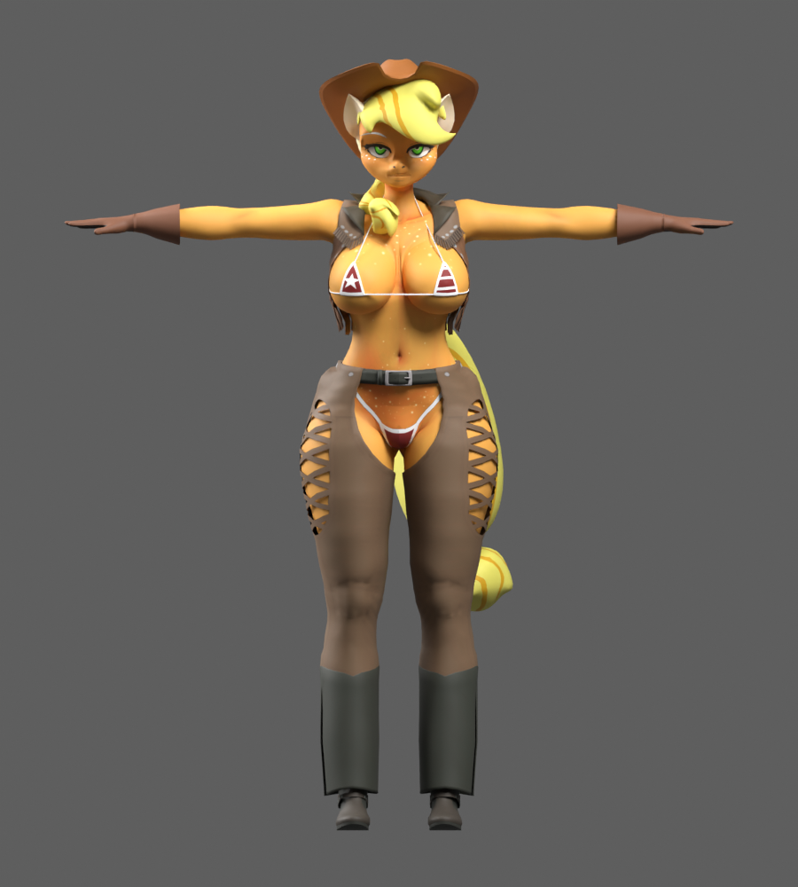
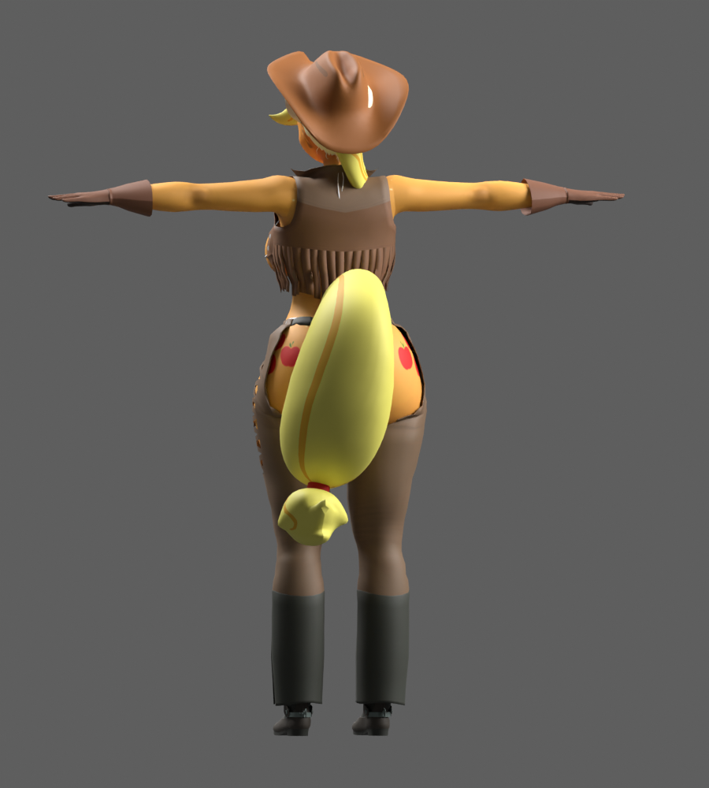

# Historical validation and implementation notes

These are recorded development observations, not guarantees for a new input or current game build. Never infer installed paths or active mods from them.

## Multi-game tests


Each successful FBX conversion compares vertex count, bone count, vertices with positive weights on actual bones, and bound mesh count after reimport. Helper vertex groups are not counted as skinning. This checks structural preservation, not gameplay, shader parity, or animation contact quality.

Recorded local tests:

| Input | Result |
|---|---|
| Queen Geist VPK | 273,498 vertices / 899 bones / 2 bound meshes preserved |
| St. Louis KKBP prepared scene | 60,709 vertices / 904 bones / 4 bound meshes; 60,377 bone-weighted vertices preserved |
| Celestia KKBP PMX → automatic bake → FBX | 34,206 vertices / 804 bones / 3 bound meshes preserved; 29 materials baked. Installed-game appearance differs from card preview |
| Four example Koikatsu PNGs | Appended card payloads inspected successfully |
| ZZZ Sixth Streetwear Belle, selected hair draw ranges | 3,534 vertices / 292 bones / 1 bound mesh preserved; all vertices weighted. Neutral render inspected; all 3,534 vertices respond to a 25-degree head rotation. Full outfit blocked by incomplete bone mapping |

Generated models, game files, cards, personal configuration and vendor binaries are excluded from this source repository. Treat a successful file conversion and an in-game-tested mod as separate milestones.

### Deadlock sample skins (2026-11-14)

Built and imported through Deadlock Mod Manager 2.2.0:

| Skin | Target | Runtime observation |
|---|---|---|
| StLouis_Lash | Lash | Textured model loaded and followed the hideout idle animation; naval accessories retained |
| Belle_McGinnis | McGinnis | Textured model loaded and animated; wrist/weapon contact needs further tuning |
| Pheony_Apollo | Apollo | Textured model loaded and animated; long hair has substantial secondary motion and needs further tuning |

These are initial playable test builds, not full combat-validation passes. Movement, firing, reloads, abilities and physics extremes still need dedicated testing. Hideout screenshots were saved locally; they are not proof of those remaining checks.

After the tests, the existing Buck McGinnis and Lashlyn skins were restored as active. Belle and St. Louis remain available as disabled alternatives in the library. Apollo remains enabled. To switch alternatives, enable the desired skin and choose **Swap mods**, then restart Deadlock; do not enable two replacements for the same hero together.


## Studio sample


On November 14, 2026, the first existing AppleJack card in Studio was exported with her loaded hair, hat, tail and cowgirl outfit. The bridge captured 27 renderers and 41 PNG textures. The converter excluded two shader-only helpers. A fresh FBX import retained all 25 visible meshes, 42,697 vertices and 378 bones, with every vertex weighted. A 15-degree head rotation moved the hair and hat while the tail and boots stayed stationary.

The complete output was copied to another folder and reimported with image searching disabled. All referenced images loaded from the copied texture folder. These are neutral Blender renders of that FBX, not game screenshots:





The game reported missing zipmods when loading this card. This test preserves the appearance actually loaded in Studio; it does not prove every item from every outfit is installed. Exact toon shading, small overlay details, facial morphs and physics remain outside this bridge's scope. Maker/KKBP is still available for its material-baking workflow. The new Sunshine conversion has passed file-preservation checks, but acceptance of its generated card in Maker remains unresolved; this Studio test used the existing card that already loaded there.


## Marvel Rivals technical reference

```text
MARVEL RIVALS MODS TO TEXTURED, RIGGED FBX — VERSION 3

Launch RivalsFbxConverter.exe. Keep this whole folder together.
Python is bundled; Blender and a local Marvel Rivals installation are required.
Select your local Blender executable and installed game Paks folder.

1. Add files (.utoc, .pak, or .ucas), or add a folder recursively.
   Each matching .utoc/.ucas pair is one job. Do not separate companion files.
   For .7z/.zip downloads, unpack them first.
2. Choose an output folder and click Convert batch.
3. Each job gets a unique folder containing FBX/, extracted/, logs and a report.
   Failed jobs do not stop the rest of the batch. Cancel stops the current process.
   The four supplied test folders can be added with Load four samples.

WHAT IS PRESERVED
Original skeletal hierarchy, bind pose and skin weights, UVs and mesh geometry.
The highest-detail mesh is exported, including separate lobby assets when present.
Every FBX is reopened in Blender; bone/vertex/weighted-vertex counts, armature
binding and a test bone deformation must pass before the job is marked Verified.
Each FBX is copied ALONE into a temporary directory and reopened. Material slots
and every assigned color/normal/roughness/metallic/emission image must load from
the embedded data, without referring back to extracted source textures.
This is the game's deformation skeleton, not the artist's original control rig.
Animation clips, physics setups and Unreal shader graphs are not reconstructed.

AUTOMATIC MATERIALS
The converter reads the installed game's archives alongside the selected mod.
Mod replacements retain priority. It follows material instance inheritance and
loads missing textures from the base game. Only the selected mod assets and
their material dependencies are exported; other installed mods are not scanned.
Exact material-slot references drive assignment, not filename similarity.
For null duplicated slots, a unique named base slot in the same mesh may be used;
the per-mesh report records this substitution.

Color maps and opacity masks are combined into RGBA PNGs. Packed ORM maps are
split into separate AO, roughness and metallic images. Normal-map green channels
are flipped from DirectX to OpenGL convention. Textures are embedded in the FBX.
Separate PNGs and original material parameters remain under extracted/.
material_recipes.json records which maps came from the mod or installed game.
Missing selected texture references fail the job rather than silently using white.

SHADER LIMITATIONS
FBX cannot carry Unreal shader graphs. The output uses portable PBR materials.
Iris/sclera are composited; refraction, parallax, anisotropic hair, animated FX,
and layered/dye shader behavior are approximated. Runtime-only effect overlays
without a base surface are transparent in the static model. AO images are provided
separately because FBX has no universal AO channel. Appearance can vary by importer.
This is automatic textured export, not a pixel-identical copy of the game renderer.

FORMAT HANDLING
Uses GAME_MarvelRivals, a bundled .usmap and the installed game's global.utoc/ucas.
Each mod is staged independently to avoid replacement path collisions.
The tested Twilight package has a plaintext index and AES-encrypted payload blocks.
The converter handles that observed v5 layout using the published game key and
temporary copies. It never writes into the input mod files or game installation.
Other encryption keys/layouts and incompatible mapping versions may need updates.
First use may download decompression libraries through CUE4Parse into Windows Temp.

COMMAND LINE (with Python, cryptography, Pillow and numpy installed)
python converter.py "C:\path\mod folder" "C:\path\another mod" --output "C:\Exports"
Optional: --game "...\Content\Paks" --blender "...\blender.exe" --mappings file.usmap

DEPENDENCIES / SOURCES
CUE4Parse.CLI custom untrimmed build, Apache 2.0:
https://github.com/joric/CUE4Parse.CLI
https://github.com/FabianFG/CUE4Parse
License and third-party notices are in tools/.
Published game key:
https://github.com/picarica/Marvel-modding-guide
Current mapping:
https://github.com/SpaceDepot/rivals-depot/tree/main/usmap
Bundled mapping: 5.3.2-4042190+++depot_marvel+S11.0_release-Marvel.usmap
The portable release includes the current mapping metadata; select another mapping for incompatible game versions.
New game updates can require selecting an updated .usmap in the GUI.
Blender: https://www.blender.org/ (installed separately, GPL)
Python: https://www.python.org/
cryptography: https://cryptography.io/ (Apache-2.0 OR BSD-3-Clause)
PyInstaller: https://pyinstaller.org/ (GPL with bootloader distribution exception)

Source code is included: converter.py, materials.py, hair_bake.py and blender_convert.py.
Backend modifications and reproducible build instructions are in backend-source/.

HAIR COLORS (VERSION 3)
Inherited BaseTint/BaseColorTint values are applied in linear light. The material
report retains the resolved scalar, color and switch parameter data. Hair
ShadowColor(UV1) maps are multiplied with UV0 albedo and opacity in a baked atlas,
including per-mesh UV layouts. No character-specific color guesses are used.
For compatibility with FBX importers, affected hair faces use the atlas in their
first UV channel; the original first channel is retained as Original_UV0.
Hair normal maps are omitted on these faces because their tangent frame changes;
the mesh normals remain. This preserves source color placement, not exact Unreal
anisotropic highlights, runtime dye effects or lighting. No in-game screenshot
comparison has been performed.

```
